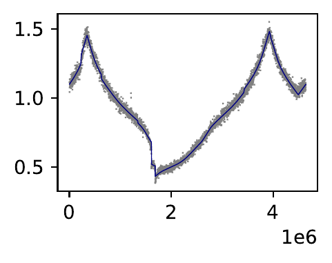
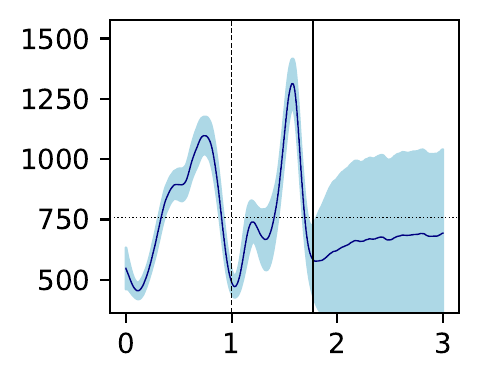

# VeloGP

## Overview

`VeloGP` infers how fast DNA replication forks (replisomes) move from
*marker frequency analysis* (MFA-seq) data. In an exponentially growing
population, regions close to a replication origin are replicated early and are
therefore more abundant than regions replicated late. From the DNA abundance
along the genome, VeloGP reconstructs

  - the fork velocity v(t) as a function of time since initiation,
  - the firing delays of additional replication origins, and
  - the delays that forks incur at chosen genomic features (e.g. *ter* sites or
    highly transcribed genes).

The fork velocity is estimated non-parametrically: log v(t) has a Gaussian-process
prior, so no particular shape of v(t) is assumed.

## How it works

VeloGP fits a deterministic model of replication to the abundance profile:

1. Every origin fires once, possibly after a delay. Its two replisomes move
   away from it at speed v(t), slowed down at the chosen features. Replisomes
   stop when they meet, and an origin that is replicated before it fires never
   fires.
2. This gives the time t(x) at which each position x is replicated. In a
   population growing at rate λ, the expected abundance of x is then
   proportional to exp(−λ · t(x)).
3. The velocity v(t), the origin delays and the feature slow-downs are fitted
   to the observed abundances by maximum a-posteriori estimation, and their
   standard errors are obtained from a Laplace approximation.

**VeloMix** (`velogp.velomix`) extends a finished VeloGP fit with stochastic
events. Instead of a delay, each additional origin fires with some probability,
and chosen stall sites block replisomes with some probability. The abundance is
then a mixture over all combinations of these events, and VeloMix estimates the
probabilities.

The models are described in [docs/velogp.md](docs/velogp.md) and
[docs/velomix.md](docs/velomix.md).

## Example

VeloGP fit of an *E. coli* strain with the ectopic origin oriZ in addition to
oriC, grown in LB at 37 °C (origins oriC and oriZ; delays estimated at the rRNA
genes and *ter* sites).

| Abundance (`--plot-abundance`) | Fork velocity (`--plot-vt`) |
|---|---|
|  |  |
| Relative DNA abundance along the chromosome (position in bp). Grey: data in 1 kb windows; blue: VeloGP fit. The peaks are oriZ (left) and oriC (right), the drop near 1.6 Mb is the *ter* region where forks are blocked. | Fork velocity v(t) in bp/s, time in doubling times since oriC fired. Blue band: ± 2 std. err.; dotted line: geometric-mean velocity v0; dashed line: one doubling time; solid line: time at which the last window is replicated. |

## Using VeloGP via MFASeqPipeline

VeloGP is integrated into [MFASeqPipeline](https://github.com/oist/MFASeqPipeline),
which maps the sequencing reads, determines which regions can be mapped
reliably, computes the abundance profile, and then runs VeloGP (step `velogp`)
and VeloMix (step `velomix`). The pipeline includes VeloGP and an environment
with all its dependencies, so **using VeloGP through MFASeqPipeline is the
easiest way to use it**, and there is no need to install VeloGP separately. See
the [MFASeqPipeline README](https://github.com/oist/MFASeqPipeline#readme) for
installation and a quick start, and the
[`velogp`](https://github.com/oist/MFASeqPipeline/blob/master/docs/mfa_pipeline.md#velogp)
and [`velomix`](https://github.com/oist/MFASeqPipeline/blob/master/docs/mfa_pipeline.md#velomix)
steps for their settings.

## Standalone installation

VeloGP needs Python ≥ 3.10 with PyTorch, NumPy, pandas, Biopython, bcbio-gff and
matplotlib. With conda:

```bash
conda create -n velogp -c conda-forge -c bioconda python pytorch numpy pandas biopython bcbio-gff matplotlib
```

```bash
conda activate velogp
```

```bash
git clone git@github.com:oist/VeloGP.git
```

VeloGP is not installed as a package. Run it as `python -m velogp` and
`python -m velogp.velomix` from the checkout, or from anywhere after adding the
checkout to `PYTHONPATH`:

```bash
export PYTHONPATH=/path/to/VeloGP
```

## Usage

### Through MFASeqPipeline

Add the steps `velogp` and (optionally) `velomix` to the steps of the
replicating samples in the project file, and set the origins, the features at
which delays are estimated and the stall sites. For *E. coli* with the
chromosomal origin oriC and an ectopic origin oriX, delays at all rRNA genes
and *ter* sites, and stalling at terA and terD:

```yaml
use: mfa_pipeline
project: myproject
base_dir: /data
origins: oriC,oriX                        # names of features in origins.bed
velogp_vx_types: rRNA                     # GFF feature types ...
velogp_vx_names: terA,terB,terC,terD,terE,terF,terG,terH,terI,terJ  # ... and feature names with delays
velogp_errormodel: true                   # account for overdispersion
velomix_stall_sites: terA:head,terD:head  # stall sites for velomix
targets:
  exponential:
    override:
      steps: [ map, fastqc, mapstats, mappability, abundance, velogp, velomix ]
    targets:
      - sample: exp1
        reference: stat1
```

This writes `exp1.velogp.*` and `exp1.velomix.*` to the results directory. See
[Input and output files](#input-and-output-files) below for their formats.

### Fitting a VeloGP model

The basic run fits v(t) for a genome whose single origin is a GFF feature of
type `origin_of_replication` (the default for `--origins`). The input is an
[abundance file](https://github.com/oist/MFASeqPipeline/blob/master/docs/abundance_format.md)
from MFASeqPipeline, and the growth rate is given in 1/hour:

```bash
python -m velogp \
  --genome genome.fasta --gff genome.gff \
  --growthrate 1.386 --error-model --seed 42 \
  --out-abundance exp1.velogp.abd.gz \
  --out-trajectories exp1.velogp.vt.gz \
  --out-objects exp1.velogp.pkl \
  --plot-abundance exp1.velogp.abd.pdf --plot-vt exp1.velogp.vt.pdf \
  exp1.abd.w1000bp.gz
```

Origins and features can also be taken from a BED file and referred to by name.
This run uses two origins, estimates delays at all rRNA genes (by GFF type) and
at the *ter* sites (by name), and writes the feature delays:

```bash
python -m velogp \
  --genome genome.fasta --gff genome.gff --bed origins.bed \
  --origins oriC,oriX \
  --vx-feature-types rRNA \
  --vx-feature-names terA,terB,terC,terD,terE,terF,terG,terH,terI,terJ \
  --growthrate 1.386 --error-model --seed 42 \
  --out-abundance exp1.velogp.abd.gz \
  --out-vt exp1.velogp.vtonly.gz \
  --out-trajectories exp1.velogp.vt.gz \
  --out-vx-feature-delays exp1.velogp.vx.gz \
  --out-objects exp1.velogp.pkl \
  exp1.abd.w1000bp.gz
```

Origins can also be given by position, e.g. `--origins U00096.3:3925860`
(1-based). Chromosomes are circular unless listed in `--linear-chromosomes`.
Abundances without a reference sample are used by selecting the columns with
`--columns seq,midpoint,sample_coverage_avg,sample_coverage_avg_stderr,sample_mappable`.
Run `python -m velogp --help` for all options; the prior and fit options are
explained in [docs/velogp.md](docs/velogp.md).

### Fitting a VeloMix model

VeloMix starts from the objects file of a VeloGP run. The stall sites must be
features for which the VeloGP run estimated delays; `head` makes them block
only head-on replisomes, as Tus/*ter* does:

```bash
python -m velogp.velomix \
  --stall-sites terA:head,terD:head --seed 42 \
  --out-probabilities exp1.velomix.p.gz \
  --out-abundance exp1.velomix.abd.gz \
  --out-trajectories exp1.velomix.vt.gz \
  --out-vx-feature-delays exp1.velomix.vx.gz \
  --out-objects exp1.velomix.pkl \
  --plot-abundance exp1.velomix.abd.pdf --plot-vt exp1.velomix.vt.pdf \
  exp1.velogp.pkl
```

### Reading the results

All tables are tab-separated with a header line, e.g. in Python:

```python
import pandas as pd
vt = pd.read_csv("exp1.velogp.vt.gz", sep="\t")
print(vt[["t", "vt", "vt_stderr"]])
```

## Input and output files

All output tables are tab-separated text with one header line, compressed if
the file name ends in `.gz` or `.bz2`. Times are in seconds, velocities in bp/s.
In MFASeqPipeline the outputs are named `{sample}.velogp.*` and
`{sample}.velomix.*`; note that the pipeline's `.vt.gz` files are
[trajectory files](docs/trajectories_format.md).

### Input

| File | Option | Format |
|---|---|---|
| Abundances | positional argument | [Abundance file](https://github.com/oist/MFASeqPipeline/blob/master/docs/abundance_format.md) (MFASeqPipeline); any tab-separated table with the columns named by `--columns` |
| Reference genome | `--genome` | FASTA, only the sequence names and lengths are used |
| Origins and features | `--gff`, `--bed` | [Feature files](docs/features_format.md) (GFF3 or BED) |
| Growth rate | `--growthrate` | A number in 1/hour. MFASeqPipeline reads it from a [growth rate file](https://github.com/oist/MFASeqPipeline/blob/master/docs/growthrates_format.md) |
| VeloGP fit (VeloMix) | positional argument | [Objects file](docs/objects_format.md) written by VeloGP's `--out-objects` |

### Output

| Option | Program | MFASeqPipeline name | Format |
|---|---|---|---|
| `--out-abundance` | both | `.abd.gz` | [Fitted abundance file](docs/fitted_abundance_format.md) |
| `--out-vt` | both | – | [Velocity file](docs/vt_format.md) |
| `--out-trajectories` | both | `.vt.gz` | [Trajectory file](docs/trajectories_format.md) |
| `--out-vx-feature-delays` | both | `.vx.gz` | [Feature delay file](docs/vx_feature_delays_format.md) |
| `--out-probabilities` | VeloMix | `.p.gz` | [Probability file](docs/probabilities_format.md) |
| `--out-objects`, `--out-model` | both | `.pkl` | [Objects file](docs/objects_format.md) |
| `--plot-abundance`, `--plot-vt` | both | `.abd.pdf`, `.vt.pdf` | [Plots](docs/velogp.md#plots-and-console-output), in the format given by the file extension (e.g. PDF, PNG) |
| `--plot-error-model` | VeloGP | – | [Plots](docs/velogp.md#plots-and-console-output) |

## Documentation

* [docs/velogp.md](docs/velogp.md): the VeloGP model, its options, and notes for
  analysis.
* [docs/velomix.md](docs/velomix.md): the VeloMix mixture model.
* [docs/](docs/README.md): index of all file formats.
